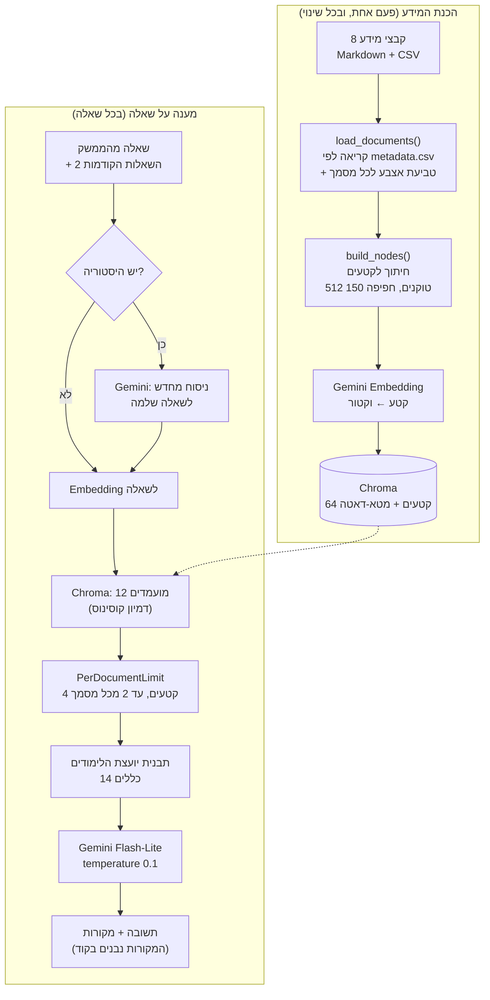

# יועצת הלימודים של שופרא – מערכת RAG

מערכת שאלות ותשובות על המידע הארגוני של **"שופרא – למידה שעובדת"**, מרחב לימודי לקורסים מקצועיים לתלמידות חרדיות. המערכת עונה בעברית, כמו יועצת לימודים: בחום ובעידוד, אבל **רק לפי המסמכים הרשמיים של המרחב הלימודי**, ותמיד עם המקורות שעליהם התשובה מבוססת.

הפרויקט נבנה ב-Python עם **LlamaIndex**, מסד הנתונים הווקטורי **Chroma**, המודלים של **Google Gemini** (במסלול החינמי בלבד), וממשק צ'אט ב-**Streamlit**.

---

## תוכן העניינים

1. [מה המערכת יודעת לעשות](#מה-המערכת-יודעת-לעשות)
2. [ארכיטקטורה](#ארכיטקטורה)
3. [מבנה הפרויקט](#מבנה-הפרויקט)
4. [התקנה והרצה](#התקנה-והרצה)
5. [המידע הארגוני](#המידע-הארגוני)
6. [החלטות תכנון ולמה קיבלנו אותן](#החלטות-תכנון-ולמה-קיבלנו-אותן)
7. [בדיקות](#בדיקות)
8. [עלויות ומכסה](#עלויות-ומכסה)
9. [בעיות שפגשנו ואיך פתרנו](#בעיות-שפגשנו-ואיך-פתרנו)
10. [מגבלות ושיפורים עתידיים](#מגבלות-ושיפורים-עתידיים)

---

## מה המערכת יודעת לעשות

- **עונה על שאלות** על 5 הקורסים, המחירים, המועדים, תנאי הקבלה, ההרשמה, ההנחות, התקנון והחופשות.
- **מייעצת איזה קורס מתאים** לפי תחומי העניין והאופי של המתעניינת, למשל "אני טיפוס לוגי ואוהבת יצירתיות". הייעוץ מבוסס על מדריך ההתאמה שבמסמך המידע הכללי, ולא על דעה של המודל.
- **מציגה מקורות** מתחת לכל תשובה: שם המסמך ותאריך העדכון שלו. רשימת המקורות נבנית בקוד ולא על ידי המודל, ולכן לא יכולה להיות מומצאת.
- **אומרת "לא נמצא מידע במסמכים"** כשאין תשובה במאגר, ומפנה למזכירות. במקרה כזה לא מוצגים מקורות.
- **נותנת מידע חלקי** כשיש רק חלק מהתשובה, למשל את הכתובת לשאלה "איך מגיעים?", ואומרת מה חסר.
- **מחשבת מחירים** צעד אחר צעד, עם הנחות, תקרת הנחה ודמי רישום, ומסיימת בשורה "סה"כ לתשלום".
- **מעדיפה מסמך מעודכן** כשיש סתירה בין מסמכים, למשל בין שאלות נפוצות מ-2025 לנוהל מ-2026.
- **מנהלת שיחה:** זוכרת את 2 השאלות האחרונות ומבינה שאלות המשך כמו "וכמה הוא עולה?".
- **מייעצת בלי להמציא:** מדגישה יתרונות רק אם הם כתובים במסמכים, לא מבטיחה עבודה או מקומות פנויים, ומזמינה לשיחת ייעוץ רק כשיש התלבטות.
- **ממשק בעברית מימין לשמאל**, עם מצב מפתחת שמציג ציוני דמיון, את הקטעים שנשלפו ואת בנק שאלות הבדיקה.

---

## ארכיטקטורה

המערכת בנויה משני תהליכים נפרדים: **הכנת המידע**, שרץ פעם אחת ובכל שינוי במסמכים, ו**מענה על שאלה**, שרץ בכל שאלה.



**הזרימה במילים:**

1. **הכנה:** כל קובץ נקרא לפי כרטיס הזיהוי שלו ב-`metadata.csv` (כותרת, גרסה, תאריך עדכון). טבלת ה-CSV הופכת לטקסט קריא, שורה לכל קורס עם שם לכל שדה. המסמכים נחתכים לקטעים חופפים, כל קטע הופך לווקטור, והכול נשמר ב-Chroma על הדיסק.
2. **שאלה:** אם זו שאלת המשך, היא מנוסחת קודם כשאלה שלמה. השאלה הופכת לווקטור, ו-Chroma מחזיר את 12 הקטעים הקרובים ביותר. מסננת הגיוון בוחרת מהם 4, עם לכל היותר 2 מכל מסמך.
3. **תשובה:** הקטעים, עם הכותרת ותאריך העדכון של כל מסמך, נכנסים לתבנית יחד עם השאלה. כל התבנית נשלחת למודל בקריאה אחת. רשימת המקורות נבנית מהקטעים שנשלפו בפועל.

---

## מבנה הפרויקט

```
shufra_project/
├── README.md
├── docs/
│   └── problems_and_solutions.md    יומן הבעיות והפתרונות (29 פריטים)
├── shufra_data/                     המידע הארגוני
│   ├── metadata.csv                 כרטיס זיהוי לכל מסמך: כותרת, גרסה, תאריך עדכון
│   ├── questions.csv                בנק שאלות הבדיקה (50 שאלות)
│   ├── facts.csv                    עובדות משותפות: דמי רישום, טלפון ושעות המזכירות
│   ├── general/   about.md, faq_2025.md
│   ├── courses/   finance.md, design.md, full_stack.md
│   ├── policies/  takanon.md, registration_payments_2026.md
│   └── tables/    prices_schedule.csv
└── shufra_rag/                      הקוד
    ├── config.py          כל ההגדרות במקום אחד: מודלים, גודל קטע, TOP_K, משפטים קבועים
    ├── ssl_fix.py         תיקון SSL לרשת מסוננת (מיובא ראשון בכל קובץ)
    ├── usage_guard.py     מונה קריאות יומי שעוצר לפני חריגה מהמכסה
    ├── check_connection.py בדיקת חיבור ל-Gemini (2 קריאות)
    ├── ingest.py          טעינת המסמכים וחיתוך לקטעים (בלי קריאות ל-Gemini)
    ├── rag.py             מנוע ה-RAG: אינדקס, שליפה, תבנית, תשובה, בדיקות
    ├── app.py             ממשק Streamlit (תצוגה בלבד)
    ├── .streamlit/config.toml  צבעים וכיבוי נתוני שימוש
    ├── requirements.txt
    └── .env.example       תבנית לקובץ המפתח
```

**חלוקת האחריות** בנויה כך שכל קובץ עושה דבר אחד. `ingest.py` לא פונה ל-Gemini בכלל, ולכן אפשר לבדוק אותו בחינם. `app.py` לא מכיר את פרטי ה-RAG, אלא רק קורא ל-`answer()`. מה שעובד בשורת הפקודה עובד גם בממשק, ולהפך.

---

## התקנה והרצה

**דרישות:** Python 3.13, ומפתח חינמי מ-[Google AI Studio](https://aistudio.google.com/).

```powershell
cd shufra_project\shufra_rag
python -m venv venv
.\venv\Scripts\activate
pip install -r requirements.txt
```

יוצרים קובץ `.env` (לפי `.env.example`) ומדביקים בו את המפתח:

```
GOOGLE_API_KEY=המפתח-שלך
```

**הרצה ראשונה:**

```powershell
python check_connection.py      # בדיקת חיבור (2 קריאות)
python rag.py --build           # בניית האינדקס (64 קריאות Embedding, פעם אחת)
streamlit run app.py            # הממשק נפתח בכתובת http://localhost:8501
```

**כל הפקודות של `rag.py`:**

| פקודה | מה היא עושה | קריאות |
| --- | --- | --- |
| `python rag.py` | מצב האינדקס | 0 |
| `python rag.py --build` | בניית האינדקס, פעם אחת | 64 |
| `python rag.py --update` | עדכון רק של מסמכים שהשתנו | לפי המסמך |
| `python rag.py --rebuild` | מחיקה ובנייה מלאה מחדש | 64 |
| `python rag.py --retrieve "שאלה"` | רק שליפה, בלי תשובה | 1 |
| `python rag.py --ask "שאלה" --chunks` | תשובה + הקטעים שנשלחו למודל | 2 |
| `python rag.py --eval` | בדיקת שליפה על כל בנק השאלות | 50 |
| `python rag.py --demo --style` | 7 שאלות דוגמה, כולל בדיקת סגנון | 14 |
| `python rag.py --followup` | שיחה של 3 שאלות המשך | 8 |

לכל אחת מ-`--retrieve`, `--ask` ו-`--eval` אפשר להוסיף `--k 6` (מספר קטעים אחר) או `--per-doc 0` (ביטול הגבלת הקטעים לכל מסמך).

---

## המידע הארגוני

המאגר כולל 8 מסמכים, 7 בפורמט Markdown וטבלה אחת ב-CSV. המידע נכתב במיוחד לפרויקט, ומתאים לאופי המרחב הלימודי: לימודים פרונטליים בלבד, לוח חופשות לפי לוח השנה העברי, ותעודות מקצועיות חיצוניות בלבד (משרד העבודה, משרד החינוך, מה"ט).

| מסמך | מה יש בו |
| --- | --- |
| `general/about.md` | הגישה, רשימת הקורסים, תעודות, מיקום, חופשות, שירותים, מדריך "איזה קורס מתאים לי" |
| `general/faq_2025.md` | שאלות נפוצות **ישנות** מ-2025 (מלכודת גרסה מכוונת) |
| `courses/*.md` | דף לכל תחום: תיאור, היקף, מועדים, מחיר, תנאי קבלה, סילבוס, תעודה, מרצה |
| `policies/takanon.md` | תקנון הלימודים בסעיפים ממוספרים (נוכחות, מבחנים, ערעורים) |
| `policies/registration_payments_2026.md` | רישום, ביטול והחזרים, הנחות, מלגות, מעבר בין קורסים |
| `tables/prices_schedule.csv` | טבלת מחירים ומועדים לכל 5 הקורסים |

**מלכודות מכוונות בנתונים**, כדי לבדוק את המערכת במצבים אמיתיים:

- **סתירת גרסאות:** ב-FAQ הישן כתוב ביטול עד 7 ימים ודמי רישום 200 ₪. בנוהל החדש כתוב 14 ימים ו-250 ₪.
- **קורסים דומים:** שני קורסי עיצוב ושני קורסי כספים, עם פרטים שונים.
- **מידע מפוזר:** מחיר בדף הקורס, דמי רישום בנוהל, והנחות בסעיף אחר.

**מטא-דאטה:** לכל קטע נשמרים כותרת, גרסה, תאריך עדכון, קטגוריה, נתיב הקובץ וטביעת אצבע. הכותרת, הגרסה והתאריך נשלחים למודל כדי שיוכל להכריע בסתירות. נתיב הקובץ, הרשאת הגישה, מזהה המסמך וטביעת האצבע **מוסתרים** מה-Embedding וממודל השפה: הם משמשים רק את הקוד, ובווקטור הם היו רק רעש.

---

## החלטות תכנון ולמה קיבלנו אותן

### חיתוך לקטעים: 512 טוקנים, חפיפה של 150
- בעברית טוקן הוא בערך אות, ולכן 512 טוקנים הם פסקה או שתיים. ניסינו 1024, וקטעים יצאו ארוכים מדי ועירבבו נושאים.
- חפיפה של 100 לא הספיקה: משפטים ארוכים לא נכנסו לחפיפה. עם 150, רעיון שנופל על קו החיתוך מופיע שלם לפחות באחד הקטעים.

### שליפה: 4 קטעים, עם גיוון בין מסמכים
- `TOP_K = 4` הוא נקודת איזון: מעט מדי מפספס מידע מפוזר, והרבה מדי מכניס רעש.
- **מסננת `PerDocumentLimit`:** שולפים 12 מועמדים, ובוחרים מהם 4 עם לכל היותר 2 מכל מסמך. בלעדיה, בשאלה על מחיר 5 מתוך 6 הקטעים הגיעו מאותו דף קורס, ונוהל הרישום נדחק החוצה. 12 המועמדים עדיין עולים קריאת Embedding אחת: ההשוואה נעשית במחשב.

### מודל השפה: דיוק לפני יצירתיות
- **`temperature = 0.1`:** במערכת מידע ארגונית רוצים עקביות. גם הסגנון החם של היועצת מגיע מההוראות בתבנית, לא מטמפרטורה גבוהה.
- **`response_mode = "compact"`:** כל הקטעים נכנסים לבקשה אחת, כלומר קריאה אחת לשאלה. במצב `refine` כל שאלה הייתה עולה 4 קריאות.
- **`context_window` ו-`max_tokens` מוגדרים מראש:** בלי שני אלה, LlamaIndex פונה ל-Google כבר ביצירת המודל כדי לברר את גבולותיו. גילינו את זה בקוד של הספרייה.

### התבנית: 14 כללים בשתי קבוצות
- **כללי תוכן (1–10) קודמים לכל דבר:** רק מהקטעים; "לא נמצא מידע" כשאין תשובה; מידע חלקי כשיש חלק; מסמך מעודכן בסתירה; מספרים בדיוק כפי שנכתבו; חישוב מחיר צעד אחר צעד; קורס שלא ברשימה = "לא נלמד"; שאלה על היועצת עצמה = תיאור קבוע.
- **כללי סגנון (11–14) מוגבלים:** חום בניסוח, בלי משפטי עידוד כלליים; משפט יתרון רק עם עובדה מהמסמכים; הזמנה לייעוץ רק בהתלבטות; בלי הבטחות ובלי לחץ.
- **הפרדה בין "מתי" ל"מה":** משפטים שהמערכת אומרת בעצמה (ההזמנה לייעוץ עם טלפון ושעות, תיאור היועצת, "לא נמצא מידע") כתובים ב-`config.py` ונכנסים לתבנית מילה במילה. המודל מחליט רק *מתי* להשתמש בהם, ולא מנחש טלפון.

### מקורות נבנים בקוד
מודל שמתבקש לכתוב "מקור: ..." עלול לטעות בשם מסמך או להמציא אותו. לכן הרשימה נבנית מהקטעים שנשלפו בפועל (`source_nodes`): כל מסמך פעם אחת, עם הציון הגבוה שלו. כשהתשובה היא "לא נמצא מידע" או תיאור היועצת, לא מוצגים מקורות, כי הם היו מטעים.

### זיכרון שיחה: ניסוח מחדש לפני החיפוש
בשאלה "וכמה הוא עולה?" אין מילה שמצביעה על קורס, ולכן הבעיה מתחילה כבר בחיפוש. לפני החיפוש המודל מנסח את השאלה מחדש כשאלה שלמה, בעזרת 2 השאלות והתשובות הקודמות. מודל התשובה לא רואה את ההיסטוריה, ולכן כל הכללים נשמרים, והשאלה המנוסחת גלויה לבדיקה. בחרנו 2 שאלות כי יותר היסטוריה מגדילה את הסיכון שנושא ישן "ייגרר" לשאלה חדשה.

### עובדה אחת, מקום אחד
דמי הרישום, טלפון המזכירות ושעות הפעילות מופיעים בכמה מסמכים ובהודעת ההזמנה לשיחת ייעוץ. כדי שלא יהיו כפילויות, הם כתובים רק ב-`shufra_data/facts.csv`. במסמכים כתוב במקומם `{{REG_FEE}}`, `{{OFFICE_PHONE}}` וכו', ו-`ingest.py` ממלא את הערכים בזמן הטעינה. גם `CONSULT_MESSAGE` ב-`config.py` נבנה מאותו קובץ.
הבחירה הזאת שומרת על איכות התשובות: הטקסט שעובר ל-Embedding ולמודל זהה לגמרי לטקסט שהיה לפני השינוי, כולל המספרים עצמם, ולכן החיפוש לא נפגע. בדקנו שטביעות האצבע של כל 8 המסמכים לא השתנו, כך שלא נדרשה שום קריאת Embedding. המילוי נעשה לפני חישוב טביעת האצבע, ולכן כששינוי ערך ב-`facts.csv`, `--update` מטמיע מחדש רק את המסמכים שמשתמשים בו. אם במסמך מופיע ערך שחסר בקובץ, הטעינה נעצרת עם הודעת שגיאה, כדי שלא יגיע לבוט טקסט עם סוגריים במקום מספר.
ה-FAQ הישן מ-2025 נשאר עם דמי הרישום הישנים (200 ₪), כי הוא מסמך היסטורי ומשמש בכוונה כמלכודת גרסאות.

### עדכון חלקי של האינדקס
לכל מסמך נשמרת טביעת אצבע (SHA-256) של התוכן והמטא-דאטה. `--update` משווה בין הטביעות ושולח ל-Embedding רק מסמכים שהשתנו. הוא קודם מחשב את הווקטורים החדשים, ורק אחר כך מוחק את הישנים, כך שתקלה באמצע לא פוגעת באינדקס.

### שמירה על המכסה החינמית
- `usage_guard.py` סופר כל קריאה בקובץ יומי, ועוצר לפני חריגה. הגבולות (300 ליום לכל סוג) נמוכים בכוונה מהמכסה האמיתית.
- בניית האינדקס שולחת קטעים בקבוצות של 20, עם הפסקה ביניהן, כדי לא לחרוג מהמגבלה לדקה.
- החלטנו **לא** להחליף מודל אוטומטית כשהמכסה נגמרת: השימוש רחוק מהגבול, ושגיאת 429 היא בדרך כלל מגבלה לדקה, שעוברת אחרי המתנה.

### הממשק
- Streamlit מריץ את כל הקובץ מחדש בכל לחיצה. `st.cache_resource` שומר את המנוע בזיכרון, ו-`st.session_state` שומר את השיחה.
- **עברית:** CSS שהופך את הכיוון, ופונקציה `fix_bidi()` שעוטפת מספרים בתווי כיווניות בלתי נראים. בלעדיה, "09:00–15:00" הוצג הפוך.
- **תקלות לא מפילות את העמוד:** מכסה שנגמרה או שגיאת רשת מוצגות כהודעה, והפירוט המלא מודפס בטרמינל.

### סביבה
רשת מסוננת (כמו נטפרי) גרמה לשגיאת SSL ב-Python 3.13. הפתרון: הספרייה `truststore`, שמשתמשת בתעודות של Windows. היא מופעלת ב-`ssl_fix.py`, שמיובא ראשון בכל קובץ.

---

## בדיקות

**בנק השאלות** (`shufra_data/questions.csv`) כולל 50 שאלות מ-28 סוגים. לכל שאלה יש תשובה צפויה, מסמכי המקור, והסבר מה היא בודקת.

| קבוצה | דוגמאות לסוגים |
| --- | --- |
| ישירות וניסוחים | `direct`, `paraphrase`, `code_lookup`, `section_number`, `typo`, `slang_short`, `english`, `long_story` |
| שילוב מידע | `multi_doc`, `multi_chunk`, `comparison`, `aggregate`, `calculation`, `date_calc` |
| מלכודות | `version_trap`, `false_premise`, `similar_courses`, `general_knowledge`, `promise_trap`, `pressure_trap`, `prompt_injection` |
| בלי תשובה מלאה | `no_answer`, `partial_info`, `out_of_catalog`, `opinion` |
| ייעוץ ומצבים מיוחדים | `advice`, `bot_meta`, `policy_edge`, `calendar` |

**דרכים לבדוק:**
- `python rag.py --eval`: האם מסמך המקור הנכון נשלף לכל שאלה. הדוח נשמר ב-`retrieval_report.csv`.
- `python rag.py --demo --style`: שאלות שבודקות גם את סגנון היועצת.
- `python rag.py --followup`: שיחה עם שאלות המשך.
- **בממשק, במצב מפתחת:** בוחרים שאלה מהבנק לפי סוג, ומתחת לתשובה מוצגת התשובה הצפויה להשוואה.

---

## עלויות ומכסה

| פעולה | Embedding | מודל שפה |
| --- | --- | --- |
| בניית האינדקס (פעם אחת) | 64 | 0 |
| עדכון מסמך אחד | מספר הקטעים שלו | 0 |
| פתיחת הממשק | 0 | 0 |
| שאלה ראשונה בשיחה | 1 | 1 |
| שאלת המשך | 1 | 2 |
| `--eval` על כל הבנק | 50 | 0 |

המונה היומי מוצג בתחתית סרגל הצד בממשק.

---

## בעיות שפגשנו ואיך פתרנו

הסיכום המלא נמצא במסמך "בעיות ופתרונות", והיומן המפורט (29 פריטים) ב-`docs/problems_and_solutions.md`. בקצרה, שש הבעיות העיקריות:

1. **כל שינוי קטן חייב בנייה מחדש של כל האינדקס (שלב 4).** פתרון: טביעת אצבע לכל מסמך ועדכון חלקי. עדכון טבלת המחירים עולה 5 קריאות במקום 58.
2. **מסמך ישן סותר מסמך חדש (שלבים 5–6).** פתרון: תאריך העדכון גלוי למודל, וכלל "סמכי על המעודכן".
3. **דמי הרישום חסרו בתשובה על מחיר (שלב 6).** האבחון הראה שזו בעיית שליפה. ניסינו יותר קטעים, אחר כך גיוון בין מסמכים, ולבסוף העשרנו את טבלת המחירים, וזה פתר.
4. **יועצת משכנעת מול נאמנות למקורות (שלב 7).** "היי חמה" הפך למחמאה קבועה בסוף כל תשובה. פתרון: הפרדה בין כללי תוכן לכללי סגנון, והוראות מה *לא* לעשות.
5. **שאלות המשך לא הובנו (שלב 7).** פתרון: ניסוח מחדש של השאלה לפני החיפוש, עם 2 השאלות הקודמות.
6. **המידע קיים, אבל לא נמצא (שלב 7).** סעיף של שני משפטים נבלע בקטע על נושא אחר. פתרון: הרחבת הסעיף וניסוח במילים שאנשים באמת שואלים.

**הלקח המרכזי:** לפני כל תיקון בודקים *איפה* הבעיה. אם הקטע הנכון לא הגיע למודל (`--chunks`), זו בעיית שליפה או נתונים. אם הגיע והתשובה שגויה, זו בעיית תבנית.

---

## מגבלות ושיפורים עתידיים

- **חיפוש היברידי:** שילוב חיפוש לפי מילות מפתח (BM25) עם החיפוש הווקטורי, כדי למצוא גם סעיפים קצרים. בעברית צריך גם להחזיר מילים לשורש, כי "להחליף" ו"החלפת" הן מילים שונות לחיפוש כזה.
- **סינון לפי מטא-דאטה:** לא לשלוף בכלל מסמכים שהוחלפו (כמו ה-FAQ הישן), במקום לסמוך על כך שהמודל יעדיף את החדש.
- **זיהוי "אין תשובה" בלי מודל:** ציוני הדמיון דחוסים מדי (0.69–0.81), ושאלה בלי תשובה קיבלה ציון גבוה משאלה עם תשובה. לכן ההחלטה נשארת אצל המודל. מודל דירוג נוסף (Re-ranker) יכול לעזור.
- **החלפת מודל אוטומטית** כשהמכסה היומית נגמרת. לא נדרש בהיקף השימוש הנוכחי.
- **עובדות נוספות במקור אחד:** כרגע `facts.csv` מכסה את דמי הרישום ואת פרטי המזכירות. אפשר להעביר אליו עוד ערכים שחוזרים בכמה מסמכים, כמו שעות קבוצות הבוקר והערב.
- **מודל ה-Embedding קבוע:** החלפתו מחייבת לבנות את כל האינדקס מחדש, כי וקטורים של מודלים שונים לא ניתנים להשוואה.
